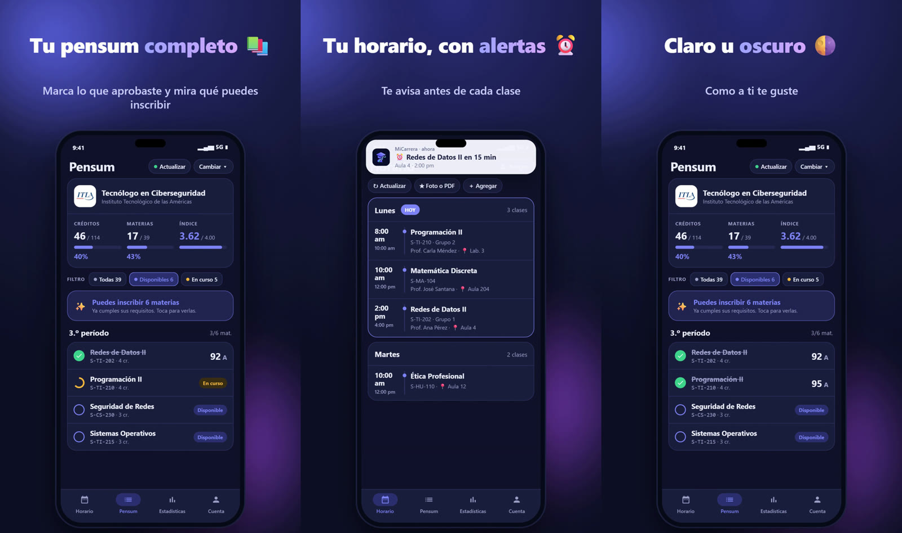

<div align="center">


# MiCarrera

**Tu pensum y tu horario, en orden**

App Android y web para estudiantes universitarios de República Dominicana

[**Abrir la web →**](https://micarrera-beta.vercel.app)



</div>

## Qué es

MiCarrera junta en un solo lugar lo que un estudiante necesita para no perderse en la universidad: su pensum con lo que ya aprobó y lo que puede inscribir, su horario con avisos antes de cada clase, sus estadísticas y un test vocacional para quien todavía no sabe qué estudiar. Tiene usuarios reales, una versión Android (publicada en la Play Store en prueba interna y como APK) y una versión web.

## Lo que hace

- **Pensum:** 37 universidades. Marcas lo que aprobaste, ves tu índice y créditos, y la app te dice qué materias ya puedes inscribir.
- **Horario con alertas:** te avisa antes de cada clase. El horario se puede llenar desde una **foto o un PDF**.
- **Estudio:** Pomodoro con aviso aunque la app esté cerrada, reto semanal, pendientes y **aula virtual (Moodle)** sincronizada por enlace de calendario.
- **Amigos:** clases en común y horas libres juntos.
- **Test vocacional** sin crear cuenta: tu perfil y las carreras y universidades que te encajan.
- **5inco**, un asistente que guía a quien entra por primera vez.
- **Avisos:** notificaciones push en Android y Web Push estándar en el navegador (sin Firebase en la web).
- Tema claro y oscuro.

## Seguridad

- Sesión cifrada con **Android Keystore**.
- Revisión de contraseñas filtradas con *Have I Been Pwned* por k-anonimato.
- RLS en todas las tablas y límites de tamaño por persona.
- Pantallas sensibles protegidas contra capturas.
- Botón para eliminar la cuenta.

## Cómo está hecho

| Parte | Tecnología |
|---|---|
| Android | Kotlin, Jetpack Compose, Material 3 (minSdk 26), dos sabores: `web` (con actualizador propio) y `play` |
| Web | React 19, TypeScript, Vite (PWA) |
| Servidor | Supabase: PostgreSQL con RLS, Auth, Edge Functions (Deno) y tareas programadas |
| Publicación | Vercel (web) · `publicar.py` (APK por etapas: primero a un probador, después a todos) |

```
android/   · app Android (Kotlin + Compose) y funciones del servidor (servidor/)
web/       · app web (React + TypeScript + Vite)
```

## Correrlo

**Web**
```bash
cd web
npm install
npm run dev
```

**Android:** abre `android/` en Android Studio. Para compilar hace falta tu propio `app/google-services.json` (Firebase). Para la versión firmada, copia `keystore.properties.ejemplo` como `keystore.properties` y pon tus datos. Esos archivos no se suben al repositorio.

---

<div align="center">

Diseño y desarrollo: **Albert Silvestre** · [Portafolio](https://github.com/SrAlbert22)

</div>
